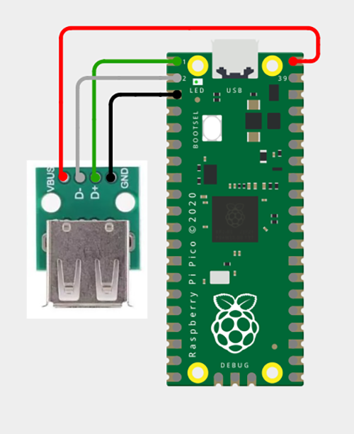
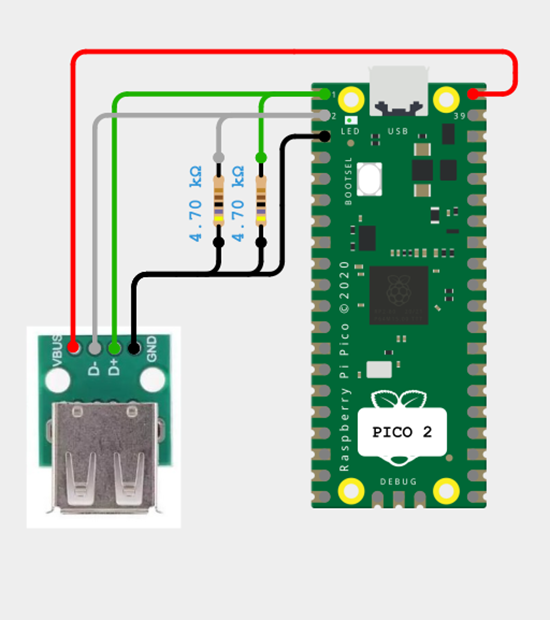
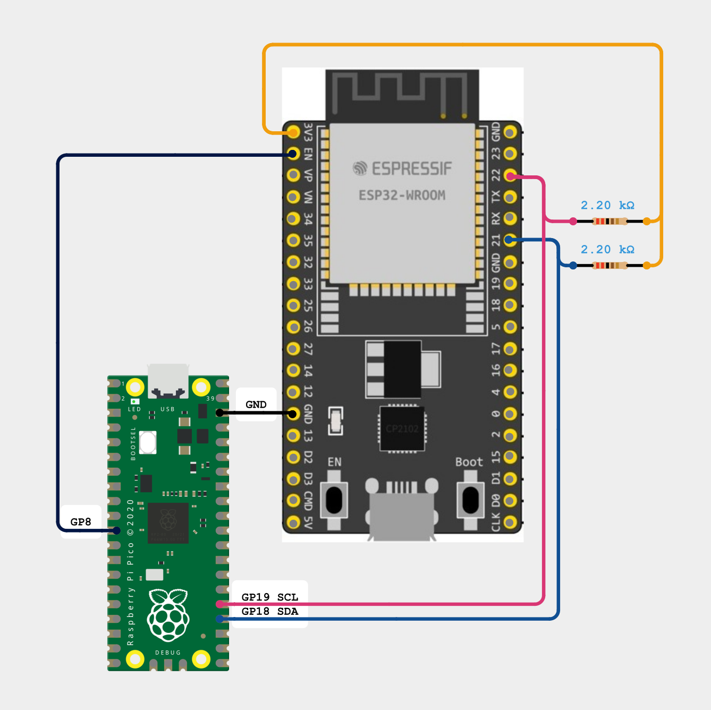
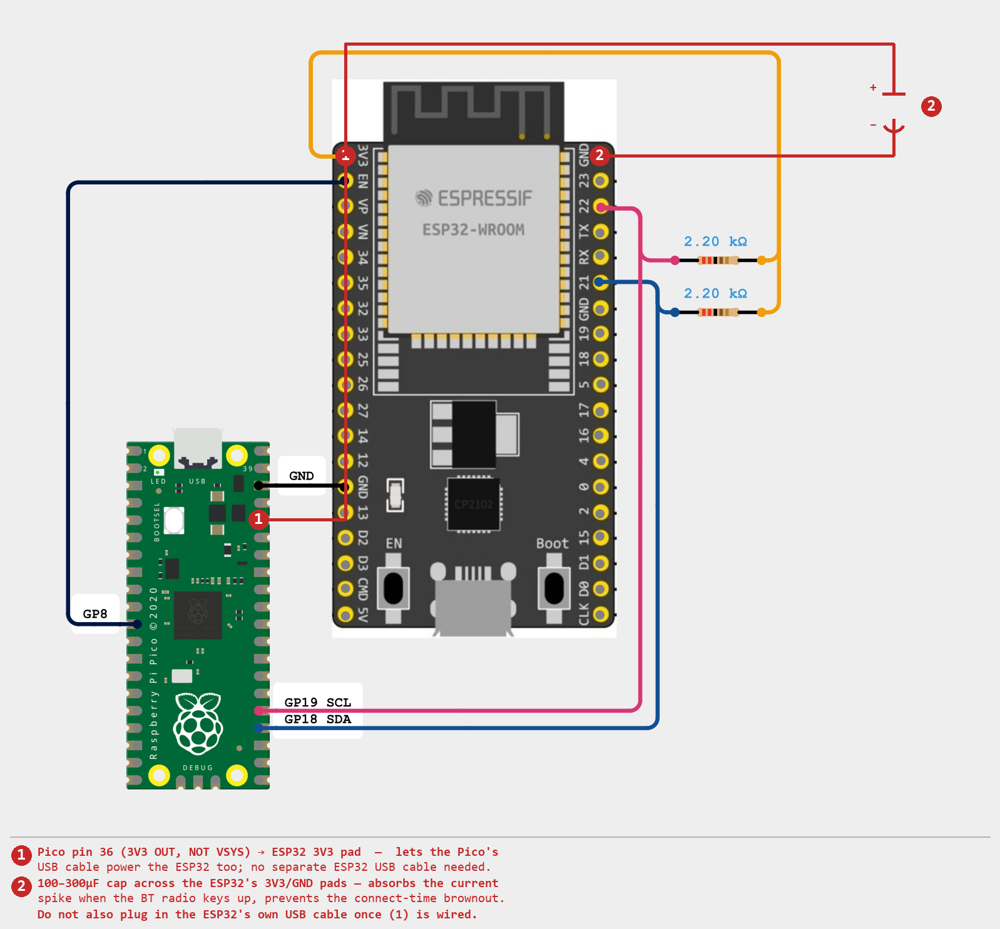
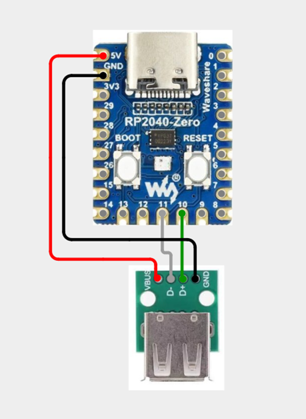
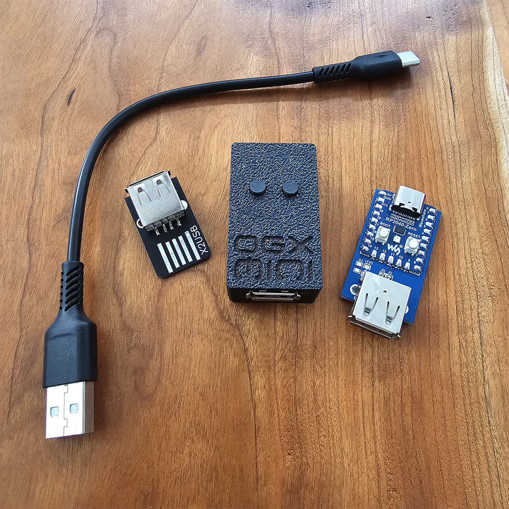

# Pi Pico

# Pi Pico 2
The Pico 2 will likely require 4.7k resistors between the USB data lines and ground to work correctly.

# Pi Pico + ESP32
This is the minumum amount of connections you'll want for this to work and the diagram assumes you're powering the Pico and ESP32 each separately via USB (do not connect power between the 2 boards if so). A more complex configuration is possible, making the Pi Pico able to program the ESP32, but I'll update the repo with that diagram later.

## Pi Pico + ESP32, single USB cable
Community-contributed variant of the diagram above for running both boards off one USB cable (on the Pico), instead of two. Two additions on top of the wiring above, shown in red:

1. A wire from the Pico's pin 36 (`3V3(OUT)`, **not** `VSYS`) to the ESP32's `3V3` pad, so the Pico's own regulator powers the ESP32 too. Leave the ESP32's USB port unplugged; only the Pico's cable is connected.
2. A 100-300&micro;F capacitor across the ESP32's `3V3`/`GND` pads, right at the pins. Without it, Bluetooth may fail to connect even though the ESP32 appears powered (LED on, boots fine) &mdash; the BT radio's current draw when it keys up for a connection attempt briefly sags the shared 3.3V rail enough to glitch the BT stack. The cap absorbs that transient. Mind polarity if it's electrolytic: flat plate (+) to 3V3, curved plate (&minus;) to GND.

Tested working on hardware (Pico + ESP32-WROOM devkit) &mdash; Bluetooth connects reliably with the cap in place.

# RP2040-Zero

Gerber, BOM, and schematic for an RP2040-Zero interposer board you can make yourself. LED1 and R3 are both optional. 

The RP2040-Zero board can be found on Amazon and AliExpress.

